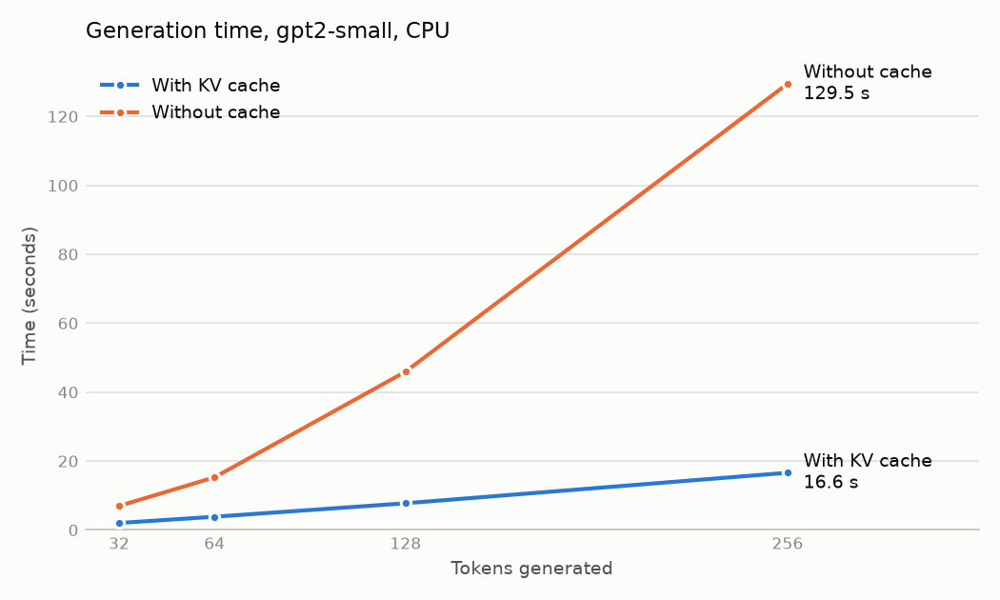
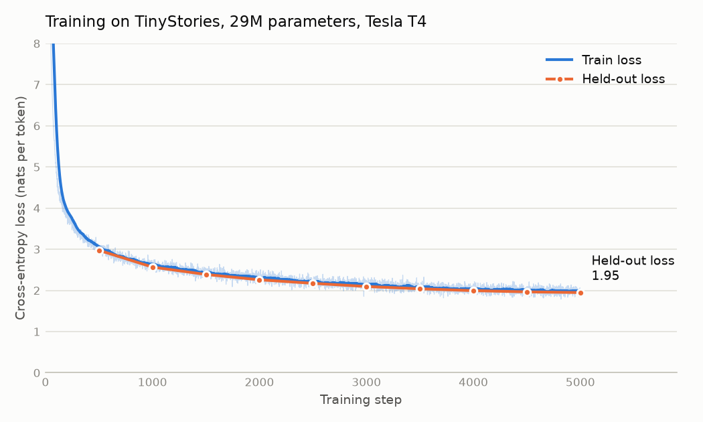
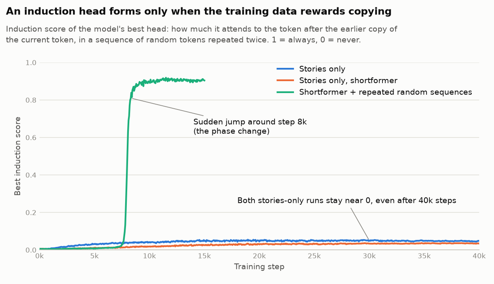
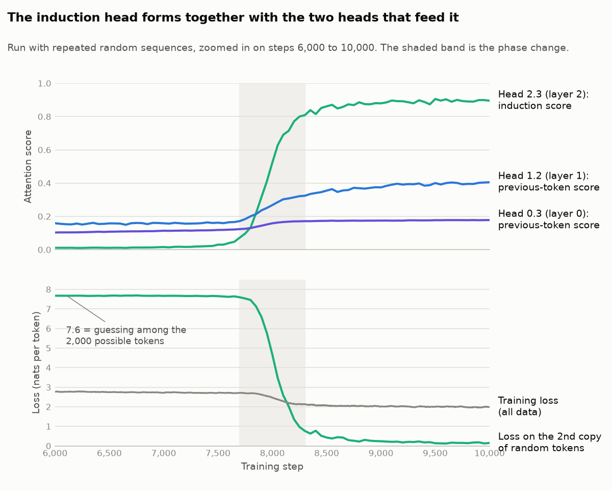
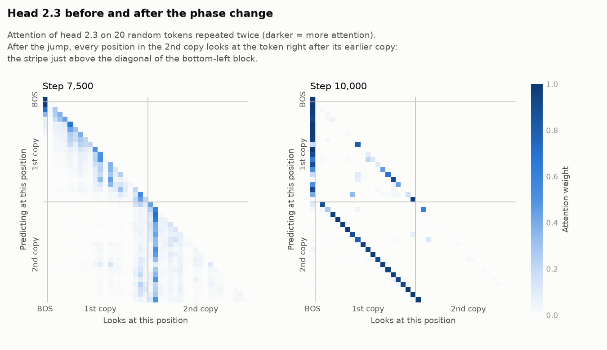
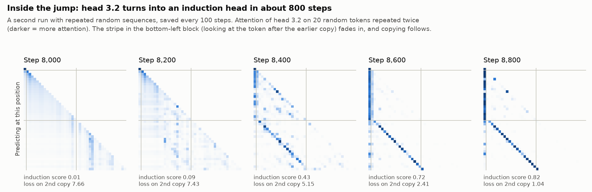
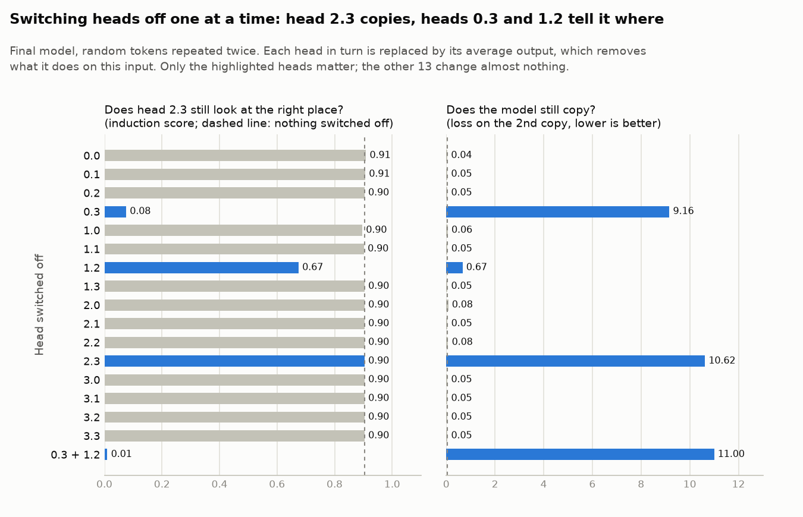
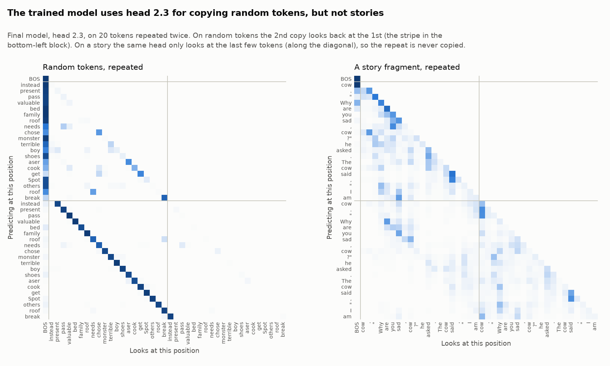
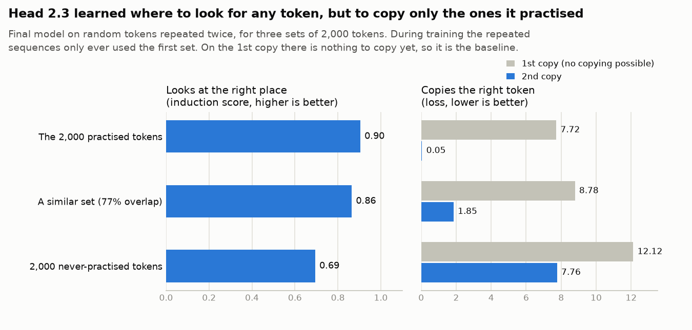
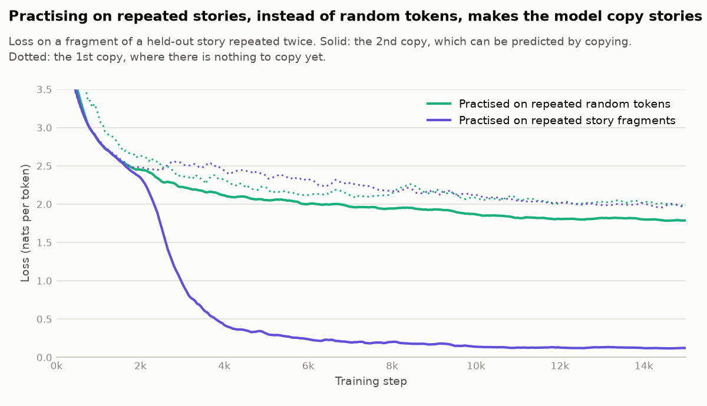

# tiny-gpt

GPT-2 implemented from scratch in PyTorch: every layer written by hand, and **verified against OpenAI's pretrained weights**. Loaded with GPT-2 small's weights, this implementation produces the same logits as Hugging Face's reference model (to within 1e-4) and the same greedy generations.

```console
$ tiny-gpt-sample "The best thing about learning machine learning is" --seed 0 --max-new-tokens 30
The best thing about learning machine learning is that when it's done correctly, you can
easily see the the trends that are happening and see what your machine learning model predicts.
```

## What's implemented

| Component | File | Notes |
|---|---|---|
| Token + learned positional embeddings | [`model.py`](src/tiny_gpt/model.py) | |
| Multi-head causal self-attention | [`model.py`](src/tiny_gpt/model.py) | Per-head weight tensors, every contraction written as a named `einsum` |
| LayerNorm, GELU MLP, pre-LN residual blocks | [`model.py`](src/tiny_gpt/model.py) | Matches GPT-2's architecture exactly |
| Loading OpenAI's GPT-2 weights | [`pretrained.py`](src/tiny_gpt/pretrained.py) | Unpacks Hugging Face's fused `c_attn` QKV matrix into per-head shapes |
| Greedy, temperature, top-k, top-p sampling | [`sample.py`](src/tiny_gpt/sample.py) | |
| KV cache | [`model.py`](src/tiny_gpt/model.py), [`sample.py`](src/tiny_gpt/sample.py) | Each new token is processed once; rebuilt when generation outgrows the context window |
| TinyStories tokenization and sequence packing | [`data.py`](src/tiny_gpt/data.py) | Stories joined with `<\|endoftext\|>`, cut into fixed-length rows |
| Training loop | [`train.py`](src/tiny_gpt/train.py) | AdamW, warmup + cosine LR schedule, gradient clipping, mixed precision, W&B logging |
| Shortformer positional embeddings (optional) | [`model.py`](src/tiny_gpt/model.py) | Positions added only to the inputs of queries and keys, not to the residual stream |
| Induction-head measurements | [`induction.py`](src/tiny_gpt/induction.py) | Attention patterns read through hook points; scores and copy losses logged during training |

No `nn.Linear`, `nn.LayerNorm`, `nn.MultiheadAttention` or `F.scaled_dot_product_attention`: the point is to show every operation explicitly.

## Verification

The test suite ([`tests/`](tests)) runs on every push via GitHub Actions:

- **Parity with GPT-2:** logits match `transformers.GPT2LMHeadModel` on real text, and greedy generation produces identical tokens, with and without the KV cache.
- **KV cache:** feeding a sequence through the cache in pieces gives the same logits as one full pass, and generation with the cache matches generation without it token for token, including past the end of the context window.
- **Causality:** changing a future token never changes the logits at earlier positions.
- **Components:** LayerNorm and GELU match PyTorch's built-in implementations; top-k and top-p only ever sample from the allowed set of tokens.
- **Shortformer:** gives the same logits as TransformerLens's shortformer model with the same weights, and is identical to the standard model when the positional embeddings are zero.
- **Training:** the training loop learns a simple deterministic sequence to >95% accuracy, checkpoints reload to identical outputs, and the learning-rate schedule and data packing are checked directly.

## KV cache benchmark

Without a cache, generating each token reruns the model over the whole sequence so far, so every token costs more than the one before. The cache stores each layer's keys and values, so each step only processes the newest token and the speed stays flat:



| Tokens generated | Without cache | With KV cache | Speedup |
|---:|---:|---:|---:|
| 32 | 6.96 s (4.6 tok/s) | 2.02 s (15.9 tok/s) | 3.4x |
| 64 | 15.27 s (4.2 tok/s) | 3.84 s (16.7 tok/s) | 4.0x |
| 128 | 45.92 s (2.8 tok/s) | 7.75 s (16.5 tok/s) | 5.9x |
| 256 | 129.47 s (2.0 tok/s) | 16.60 s (15.4 tok/s) | 7.8x |

GPT-2 small (124M), 32-token prompt, greedy decoding, on a laptop CPU (Intel Core, 4 threads). Reproduce with `python benchmarks/kv_cache.py`; raw numbers in [`docs/kv_cache_benchmark.json`](docs/kv_cache_benchmark.json).

## Training on TinyStories

The `tiny` preset (4 layers, 4 heads, `d_model` 256, 256-token context) trained from scratch on [TinyStories](https://huggingface.co/datasets/roneneldan/TinyStories): 5,000 steps of 32 × 256 tokens (41M tokens), in 21 minutes on a free Kaggle T4. It has 29M parameters, but only 3M of them are in the transformer blocks; the rest are the token embedding and unembedding of GPT-2's 50,257-token vocabulary.



| Step | Held-out loss | Next-token accuracy |
|---:|---:|---:|
| 500 | 2.97 | 40.7% |
| 1,000 | 2.57 | 45.6% |
| 2,000 | 2.26 | 49.9% |
| 3,000 | 2.10 | 52.2% |
| 4,000 | 1.99 | 54.0% |
| 5,000 | 1.95 | 54.8% |

Held-out loss is measured on 5,000 stories from the validation split. Train and held-out loss stay together because the run sees less than one pass over the 68M training tokens, so there is nothing to overfit to yet.

Stories generated from "Once upon a time" (temperature 0.7, top-p 0.95, 80 tokens) during the run:

> **Step 500:** Once upon a time there was a little girl named Lily. One day, she went to the park and saw her doll on her doll. Her mommy was sad because she didn't want to find the toy. Lily told her that her mommy said Lily, "Lily, I want to play outside." Lily said, "Mommy, I'm sorry I'm sorry," said. Lily was happy and said

> **Step 5,000:** Once upon a time there was a little girl called Sally. She was three years old and loved to explore the world around her. One day, Sally found a big, green tree with lots of red, yellow, green fruit. She was so excited to try it out and reach the tree.
>
> Suddenly, she heard a voice. It said, "Be careful, Sally. You can't reach the tree and

At step 500 the model has the vocabulary and the shape of a story but loses track of who is doing what; by step 5,000 it keeps a character, a setting and a small plot going. Every logged sample is in [`docs/training_history.json`](docs/training_history.json), along with the full loss history; the chart is made by `python scripts/plot_training.py <wandb run path>`.

## Interpretability: does a small model learn induction heads?

An **induction head** is an attention head that implements copying from context: if the text so far contains "... Mr Dursley ... Mr", it predicts "Dursley". It finds the earlier occurrence of the current token and predicts whatever came after it. [Olsson et al. (2022)](https://transformer-circuits.pub/2022/in-context-learning-and-induction-heads/index.html) found these heads in every transformer they studied with two or more layers, argued that they are a main source of in-context learning, and saw them form suddenly during training, in a "phase change". The question here is whether that happens in this small model trained on TinyStories, and if not, why not.

**How it is measured.** Every 50 training steps, the model reads 16 sequences of random tokens repeated twice: `[BOS] A B C ... A B C ...` ([`induction.py`](src/tiny_gpt/induction.py)). Nothing in the first copy can be predicted. The second copy can be predicted perfectly, but only by copying from the first. Two numbers are logged:

- **Loss on the second copy.** Without copying it stays as high as on the first copy; with a working induction head it falls towards 0.
- **Induction score** of each head: how much attention a token in the second copy pays to the token right after its earlier occurrence (1 = all of it, 0 = none).

### 1. Trained on stories alone, no induction heads form

| Run (40,000 steps, 328M tokens) | Held-out loss | Best induction score | Loss on random tokens, 1st → 2nd copy |
|---|---:|---:|---:|
| `tiny`, GPT-2's positional embeddings | 1.62 | 0.05 | 11.66 → 11.11 |
| `tiny-shortformer` (see below) | 1.63 | 0.03 | 11.56 → 11.09 |

Both models write good stories, and neither learns to copy, even after 40,000 steps.

Three explanations were checked:

1. **The data doesn't reward copying.** Ruled out: in 256-token windows, "predict what came after the previous occurrence of this token" is correct for 8.4% of tokens in TinyStories, against 8.8% in WikiText-103 (Wikipedia). It is correct *and* differs from the most common next word for 4.2% of TinyStories tokens, more than Wikipedia's 2.4%.
2. **The architecture makes it hard.** On a toy task (2 layers, `d_model` 64, 200-token vocabulary, trained only on repeated random sequences), GPT-2's layout barely learns to copy, while the **shortformer** variant learns within 2,000 steps. Shortformer ([Press et al., 2021](https://arxiv.org/abs/2012.15832)) adds the positional embeddings only to the inputs of the queries and keys, instead of to the residual stream. The result is the same in this repository's model and in [TransformerLens](https://github.com/TransformerLensOrg/TransformerLens):

   | Toy model, loss on 2nd copy (1st copy: about 5.4) | 2,000 steps | 6,000 steps |
   |---|---:|---:|
   | GPT-2 positional embeddings (this repo, init scale 0.1*) | 4.28 | 4.03 |
   | GPT-2 positional embeddings (TransformerLens) | 4.20 | 4.03 |
   | Shortformer (this repo) | 0.48 | 0.02 |
   | Shortformer (TransformerLens) | 0.19 | 0.00 |

   \* With GPT-2's usual init scale of 0.02 it was slower still: 4.82 after 4,000 steps.

   So shortformer was added as an option (`--preset tiny-shortformer`), tested to give exactly the same logits as TransformerLens's version. But on TinyStories it was not enough by itself (second row of the table above).
3. **Copying is too weak a signal next to everything else the model is learning.** This is the explanation that remains. With only 4 layers, the model gets more out of grammar and typical story patterns, and in 40,000 steps building the copying circuit never pays off.

### 2. With a small nudge, an induction head forms suddenly

The third run uses shortformer and replaces 4 of the 32 rows in every batch with random tokens repeated over and over (`--repeat-fraction 0.125`), so that for those rows copying is the only way to lower the loss. For 7,000 steps nothing happens. Then, between steps 7,700 and 8,300, head 2.3 becomes an induction head:



Zoomed in on the jump: while the induction head (head 2.3, layer 2) forms, two heads in the layers below get better at attending to the token right before each position: head 0.3 (layer 0) and head 1.2 (layer 1). At the same time the loss on the second copy falls from 7.6 at step 7,700 to 0.76 at step 8,300, and to near 0 after that:



This is what the circuit described by Olsson et al. predicts. A previous-token head writes "the token before me was X" into each position. The induction head then searches for positions tagged with the current token, and copies the token found there. Neither part is useful without the other, which is a likely reason they change together, and why the change was sudden in both runs with random sequences (with story fragments, in section 3, it was slower). (The drop in training loss in the chart comes from the repeated rows becoming predictable, not from the stories: the held-out loss, measured on stories only, was 1.937 at step 7,500, 1.938 at 8,000 and 1.944 at 8,500.)

What head 2.3 does, before and after (darker = more attention). After the jump, each token in the second copy looks at the token right after its earlier occurrence, the clean stripe in the bottom-left block:



**Inside the jump.** A second run with the same recipe, stopped at 10,000 steps and saved every 100 steps, jumped too: between steps 8,000 and 8,800. Seen from inside, the stripe fades in over about 800 steps, and copying follows it:



**The same jump, different heads.** In this second run the induction head is head 3.2 (layer 3), not 2.3. Shortening the run changed the learning-rate schedule, so it is in effect a second seed. Its inputs are spread over more heads. Switching off head 2.0 raises the loss on the second copy from 0.20 to 2.18; head 0.3 raises it to 1.14 and head 1.2 to 0.72; none of them breaks copying alone. Head 2.0's previous-token score rose from 0.16 to 0.36 during the jump, at the same time as head 3.2's induction score. So the phase change was reproduced, but which heads carry out the circuit is not fixed.

**Which heads actually matter.** Changing at the same time is not proof that heads work together, so each of the 16 heads was switched off in turn in the final model and the copying measured again. A head is switched off by *mean-ablation*: its output is replaced by its average output over other sequences of the same kind, which removes what it does on this particular input but keeps anything constant it always writes.



- **Head 2.3 does the copying.** Without it, the loss on the second copy goes from 0.05 to 10.6, as bad as having no copy at all. Its attention is unchanged (0.90): it still looks at the right place, but nothing is written from there.
- **Heads 0.3 and 1.2 tell it where to look.** Without head 0.3, head 2.3's induction score falls from 0.90 to 0.08 and copying fails (loss 9.2). Without head 1.2 it falls to 0.67 (loss 0.67). Without both, to 0.01 (loss 11.0). Their output is what head 2.3 uses to find the right position.
- **The other 13 heads barely matter for this task** (induction score 0.90–0.91, loss at most 0.08).

Two surprises here, both of which only ablation could reveal. First, head 0.3 matters most, although by its attention pattern it is the weaker previous-token head (score 0.18, against 0.41 for head 1.2). Second, head 1.3, which always attends to the BOS token, seemed essential in a first test that switched heads off by setting their output to zero: copying failed without it (loss 7.9). With mean-ablation it makes no difference at all (0.05). It writes the same vector every time, and the rest of the model relies on that constant being there; removing it breaks things for reasons unrelated to copying. That is why mean-ablation is used here.

### 3. The model uses the head on the kind of text it practised on

In the run that practised on random tokens, testing on a repeated story fragment instead gives a different picture. On the second copy of real story text the head does not look back at the first copy at all (induction score 0.000). It attends to the last few tokens instead, and the loss on the second copy barely drops: 1.91 → 1.75, compared with 7.72 → 0.05 for random tokens. The phase change didn't affect this either: in the measurements logged during training, the second copy of a story was no easier after step 8,300 than before.



Switching head 2.3 off on stories raises the loss on *both* copies by about the same amount (by 0.10 and 0.11). So on stories it does some general, local job, not copying. The same is true for every other head: none of them, switched off, hurts the second copy of a story much more than the first (the largest difference is 0.07). The model has learned when to copy: in random-looking text, yes; in stories, no.

The head is also narrow in a second way. The repeated training sequences only ever used the 2,000 most common tokens. On sequences built from other tokens, the head still **looks** at the right place fairly well, but **copies** much worse:



In terms of the circuit: the part that decides *where to look* (the QK circuit, which matches "previous token was X" against "current token is X") generalises to tokens it never practised on. The part that decides *what to write* (the OV circuit, which turns the attended token into a prediction of that same token) was mostly learned for the tokens it practised.

**Practising on stories instead.** A last run replaced the repeated random tokens with fragments of real training stories, repeated to fill the row (`--repeat-source story`), everything else unchanged. Now the model does copy stories it has never seen: at step 15,000 the loss on the second copy of a held-out story is 0.12, against 1.79 in the run that practised on random tokens (the first copy is about 2.0 in both).



- **Again the copying is done by one head, 3.2.** On stories it looks back at the earlier copy (induction score 0.82). Switched off, the loss on the second copy goes from 0.10 to 1.55, close to the first copy (1.91). Switching off head 0.3 stops it finding the right place (score 0.82 → 0.38, loss 1.22), but head 0.3 also does general work on stories: without it the first copy gets worse too (1.94 → 2.84).
- **It forms more gradually.** The loss on the second copy of a story fell from 2.28 at step 2,000 to 0.84 at 3,000 and 0.38 at 4,000, then slowly to 0.12, over about 2,000 steps rather than 600–800.
- **It partly carries over to random tokens,** which it never practised on: the loss on the second copy is 4.87, against 10.95 on the first copy. Without head 3.2 it is 10.28.
- **It costs nothing in story quality:** held-out loss after 15,000 steps is 1.775, against 1.782 for the run with random sequences.

### What this means

- **Induction heads are not automatic.** A 4-layer model trained on simple stories never formed one in 40,000 steps, even though copying would have helped on some tokens. At this scale, whether the circuit forms depends on the training data making copying worth it, and on the architecture: GPT-2's positional embeddings made it much harder to learn on the toy task.
- **When it does form, it forms the way the papers describe:** together with the heads below that it depends on, and suddenly in both runs with random sequences. But which heads do the job differed between the two runs.
- **Learning a circuit is not the same as using it everywhere.** The model uses its induction head on the kind of text it practised copying: practising on random tokens gave a head that ignores stories, and practising on stories gave a head that copies stories (and, partly, random tokens).

### Limitations

- Two runs of the random-sequence recipe and one of the story recipe, no other seeds; the two random-sequence runs used different heads, so the details shouldn't be read as fixed. Small model (4 layers, 3M parameters in the blocks). Larger models trained on more varied text may well form induction heads without help, as in Olsson et al.
- Mean-ablation shows which heads matter, not exactly how they are connected. It doesn't say whether heads 0.3 and 1.2 feed head 2.3's keys (as in the textbook circuit) or its queries; path patching, or measuring composition directly from the weights, would.
- The explanation for why stories alone don't produce the head (point 3 above) fits the evidence, but was not tested directly.

### Reproduce

```bash
tiny-gpt-train --preset tiny-shortformer --repeat-fraction 0.125 --max-steps 15000 --induction-every 50 \
    --snapshot-steps 7500,10000 --out-dir checkpoints/repeat
# the second run, saved every 100 steps through the jump
tiny-gpt-train --preset tiny-shortformer --repeat-fraction 0.125 --max-steps 10000 --induction-every 50 \
    --snapshot-steps 8000,8100,8200,8300,8400,8500,8600,8700,8800,8900,9000 --out-dir checkpoints/dense
# practising on repeated story fragments
tiny-gpt-train --preset tiny-shortformer --repeat-fraction 0.125 --repeat-source story --max-steps 15000 \
    --induction-every 50 --out-dir checkpoints/story
python scripts/plot_induction.py --checkpoints checkpoints/repeat --story-checkpoints checkpoints/story \
    --dense-checkpoints checkpoints/dense --out-dir docs
```

The script reads the logged measurements of the five runs (saved in [`docs/induction_history.json`](docs/induction_history.json)) and computes the numbers in this section from the final model and its snapshots ([`docs/induction_results.json`](docs/induction_results.json)).

## Quick start

```bash
pip install -e ".[dev]"
pytest                      # downloads GPT-2 small (~500 MB) on first run
tiny-gpt-sample "Once upon a time" --temperature 0.8 --top-p 0.95
```

### Training

```bash
pip install -e ".[train]"
tiny-gpt-train --preset tiny --max-steps 5000 --wandb-project tiny-gpt
tiny-gpt-sample "Once upon a time" --checkpoint checkpoints/model.pt
```

To train on a free GPU, open [`notebooks/train_on_kaggle.ipynb`](notebooks/train_on_kaggle.ipynb) on Kaggle.

### As a library

```python
import torch as t
from tiny_gpt import GPT, PRESETS

model = GPT(PRESETS["tiny"])                    # randomly initialised, ready to train
logits = model(t.randint(0, 50257, (2, 64)))    # (batch, position, vocab)
```

## Roadmap

- [x] From-scratch GPT-2, verified against OpenAI's weights
- [x] Sampling: greedy, temperature, top-k, top-p
- [x] Train a small model on [TinyStories](https://huggingface.co/datasets/roneneldan/TinyStories), with loss curves and sample outputs
- [x] KV cache, with a generation-speed benchmark
- [x] Induction heads: whether and when they form, the circuit behind them, and where the model uses them
- [x] Repeat real story fragments instead of random tokens: the head learned that way is used on stories
- [ ] Look for induction heads forming from stories alone at a larger scale (more layers, longer training)

## Acknowledgements

The model code started from the "Transformer from Scratch" exercises in [ARENA](https://github.com/callummcdougall/ARENA_3.0), a curriculum for ML alignment research engineering. This repository extends it into a standalone, tested package.
